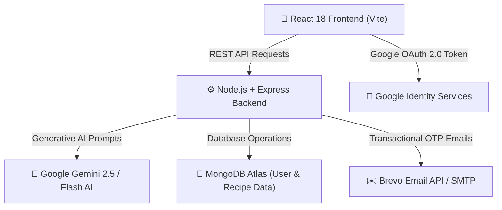

# 🍳 ChefMate AI — Your Intelligent Culinary & Cooking Companion

<div align="center">

  
  
  **From Ingredients to Plate — Dynamic, AI-Powered Step-by-Step Cooking Guides**

  [](https://react.dev/)
  [](https://nodejs.org/)
  [](https://www.mongodb.com/)
  [](https://ai.google.dev/)
  [](https://getbootstrap.com/)

</div>

---

## 🌟 Overview

**ChefMate AI** is a state-of-the-art AI-powered culinary platform designed to transform raw dish ideas and ingredients into precise, interactive, step-by-step cooking experiences. 

Unlike static recipe sites, ChefMate AI dynamically formulates tailored recipes based on your specific kitchen setup — adjusting quantities, prep times, cook times, and instructions for your chosen **servings count**, **spice tolerance**, and **appliance/cooking method** (Gas Stove, Induction, Air Fryer, Oven/OTG, or Pressure Cooker).

---

## 🚀 Key Features

### 👨‍🍳 1. AI Recipe Studio & Customization
- **Flexible Dish Generation**: Enter any dish name in natural language (e.g. *Masala Dosa*, *Paneer Butter Masala*, *Chicken Biryani*, *Creamy Alfredo Pasta*).
- **Ingredient Customizer**: Interactively review, modify, add, or remove ingredients with specific quantities, units, and custom notes before generating instructions.
- **Servings Scaler**: Automatically recalculates ingredient quantities and proportions for 1 to 10+ people.
- **Spice Level Control**: Select between *Mild*, *Medium*, *Spicy*, and *Extra Hot*.
- **Appliance Adaptability**: Tailors instructions specifically for **Gas Stove**, **Induction Cooktop**, **Oven / OTG**, **Air Fryer**, or **Electric Pressure Cooker**.

---

### ⏱️ 2. Interactive Cooking Guide & Kitchen Timer
- **Interactive Ingredient Checklist**: Check off ingredients as you prepare them with clean metric and Indian unit formatting (`grams`, `ml`, `cups`, `tsp`, `tbsp`, `pieces`).
- **Step-by-Step Cooking Timeline**: Track your live cooking progress step-by-step with active step highlighting and completion indicators.
- **Collapsible Kitchen Timer Widget**: Set timers per cooking step or master kitchen timers with audio alarms and floating control cards visible anywhere in the guide.
- **📄 1-Click PDF Recipe Export**: Instantly export customized AI cooking guides into beautifully formatted, print-ready PDF documents powered by `html2pdf.js`.
- **Chef Pro Tips & Highlights**: Gain insights from AI-generated pro tips, common mistakes to avoid, and health & nutrition notes.

---

### 🔐 3. User Accounts & Personalization
- **Dual Authentication**: Sign in with standard Email/Password credentials or seamless **Google 1-Tap OAuth 2.0**.
- **Personal Saved Recipes**: Store up to **20 saved recipes** in your personal culinary collection for quick 1-click access.
- **Cooking History Tracking**: Automatically saves your **last 5 generated recipes** per user account.
- **Brevo Email OTP Password Reset**: Forgot password flow with 6-digit OTP verification codes delivered via Brevo Email API/SMTP.

---

### 🎨 4. Premium Design & Aesthetics
- **Warm Luxury Culinary Theme**: Curated HSL color palette featuring warm deep oranges (`#ea580c`), golden accents (`#b45309`), and clean glassmorphism navigation.
- **Modern Typography**: Styled with Google Fonts **Outfit** and **Plus Jakarta Sans**.
- **Responsive Adaptive Layouts**: Seamless transition between desktop data tables and mobile card views.

---

## 🛠️ Architecture & Technology Stack



### 💻 Technology Stack Details

| Domain | Technology | Purpose |
| :--- | :--- | :--- |
| **Frontend Framework** | **React 18** (Vite) | High-performance single page client application |
| **UI & Styling** | **Bootstrap 5 + Vanilla CSS** | Responsive layouts, luxury glassmorphism, and custom tokens |
| **Icons & Visuals** | **Lucide React** | Modern, clean vector iconography |
| **Backend Server** | **Node.js + Express.js** | RESTful API routing, middleware, and authentication |
| **Database** | **MongoDB Atlas + Mongoose** | Cloud document storage for users, recipes, and history |
| **Artificial Intelligence** | **Google Gemini AI SDK** | Intelligent recipe generation and instruction tuning |
| **Authentication** | **JWT & Google Auth Library** | Secure token-based user sessions and Google OAuth 2.0 |
| **Transactional Email** | **Nodemailer & Brevo API v3** | OTP password reset emails |
| **PDF Generation** | **html2pdf.js** | Client-side export of recipes into print-ready PDF files |

---

## 📁 Repository Structure

```text
ChefMateAI/
├── backend/
│   ├── config/             # MongoDB connection configuration
│   ├── controllers/        # Auth and Recipe API route controllers
│   ├── middleware/         # JWT Authentication middleware
│   ├── models/             # Mongoose schemas (User, Recipe)
│   ├── routes/             # Express API routes (/api/auth, /api/recipes)
│   ├── services/           # Gemini AI & Brevo Email services
│   └── server.js           # Main Express server entry point
├── frontend/
│   ├── public/             # Static assets, branding logo, and icons
│   ├── src/
│   │   ├── components/     # UI components (Navbar, Timer, DishSelector, StepCard, etc.)
│   │   ├── context/        # React Context providers (AuthContext, RecipeContext, TimerContext)
│   │   ├── pages/          # Application views (Landing, Studio, Saved, History, Profile, Auth)
│   │   ├── services/       # Axios API client configuration
│   │   ├── index.css       # Global design tokens and luxury CSS rules
│   │   └── App.jsx         # Main React router application wrapper
│   └── index.html          # HTML5 entry page with Google Fonts & Meta tags
└── package.json            # Root project manifest
```

---

## 🔒 Security & Quality Features

- **Isolated User Storage**: Saved recipes (max 20) and cooking history (max 5) are strictly partitioned per authenticated user ID.
- **Safe Authentication Fallbacks**: Graceful error handling for missing OAuth credentials, offline database modes, or blocked script APIs.
- **Robust Session State Persistence**: Form state and password reset progress persist across mobile tab switches using `sessionStorage`.
- **Clean Input Sanitization**: Input validation and password hashing powered by `bcryptjs`.

---

<div align="center">

  **ChefMate AI** — *Crafted with ❤️ for passionate home chefs and culinary enthusiasts.*

</div>
